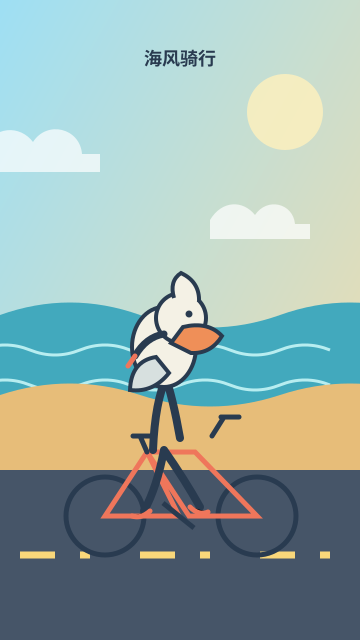

# Pelican Bicycle Animation

一个适配手机竖屏的自包含 SVG 动画：鹈鹕骑着自行车沿海边道路前进。

## 使用

直接在浏览器打开 `pelican-bicycle.svg`，或将它嵌入网页：

```html

```

SVG 使用 `viewBox="0 0 360 640"`，会随容器等比例缩放，并支持 `prefers-reduced-motion`。

## 构建

GitHub Actions 会在每次推送和 Pull Request 时检查 SVG 是否为有效 XML，并上传 SVG 构建产物。

## 说明

本项目由 AI 开发，动画和图形可能存在细节缺陷，欢迎提交 Issue 或 Pull Request。
